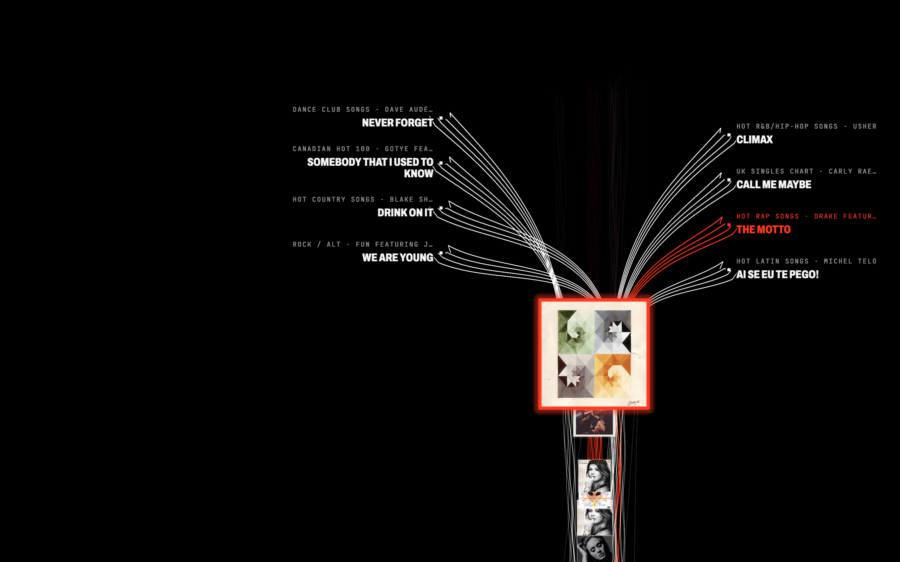
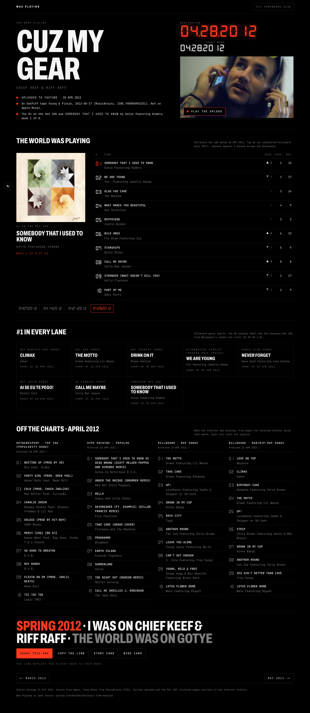
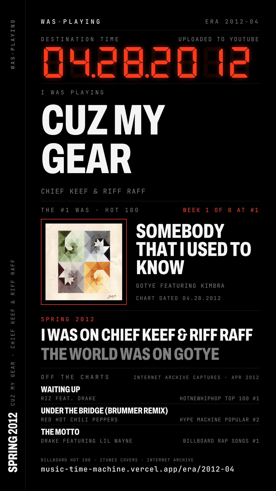

<div align="center">

# Was Playing

**The music time machine. Name a song you lived with, fly back through every #1 to the week it was playing, and land in its era.**

[**Fly back →**](https://music-time-machine.vercel.app) &nbsp;·&nbsp; [Design](docs/superpowers/specs/2026-10-20-era-engine-design.md) &nbsp;·&nbsp; [Plan](docs/superpowers/plans/2026-10-20-era-engine.md) &nbsp;·&nbsp; [Changelog](CHANGELOG.md)



</div>

<!-- STATS:BEGIN -->
<table>
<tr>
<td align="center"><strong>3,561</strong><br><sub>Hot 100 weeks, 1958–2026</sub></td>
<td align="center"><strong>1,197/1,201</strong><br><sub>#1 songs with their cover</sub></td>
<td align="center"><strong>53,930</strong><br><sub>songs in the search index</sub></td>
<td align="center"><strong>8</strong><br><sub>genre and country charts</sub></td>
<td align="center"><strong>216</strong><br><sub>months of archived blog charts (2008–2025)</sub></td>
<td align="center"><strong>1973–2025</strong><br><sub>US revenue by format (RIAA)</sub></td>
</tr>
</table>

<sub>Counted from the data in <code>public/era/</code> on 2026-10-20 by <code>data/scripts/readme_stats.py</code>; charts through 2026-10-24.</sub>
<!-- STATS:END -->

## What it does

Type `cuz my gear chief keef`. Chief Keef and Riff Raff's "Cuz My Gear" went up on YouTube on 28 April 2012 and onto a DatPiff tape three weeks later; Apple's catalog search has no match for it. Was Playing finds it anyway, then flies you back along the Hot 100's timeline, one #1 cover per run, while the genre charts branch around it like timelines off a sacred one. It lands on that week and shows you:

- **The world that week**: the Hot 100 top 10, and the #1 in R&B/Hip-Hop, Rap, Country, Rock/Alternative, Dance, Latin, the UK and Canada.
- **Off the charts**: what the internet was playing, from pages the Internet Archive saved that month (HotNewHipHop, Hype Machine, Billboard's genre pages), each list linked to its capture.
- **How people paid for music** that year: US revenue by format, from the RIAA.
- **Remembered by listeners**: songs people say were hot that month, fact-checked against release dates before they appear, and kept even when the song blew up years after it came out.
- **A card to post**: "SPRING 2012 · I WAS ON CHIEF KEEF & RIFF RAFF · THE WORLD WAS ON GOTYE", as a 9:16 story and a link preview. The link replays the flight.

| The flight | The era | The card |
|---|---|---|
|  |  |  |

## How it knows

History does not change, so it is computed once and served as static files. Only resolving a song the index has never seen happens live, in your browser, so the rate limits of MusicBrainz and Apple apply per visitor. When none of them knows the song, the server asks YouTube once and dates it by the upload; that is where most songs that never reached a store were released. Each answer is cached for a day (YouTube's terms allow at most 30), so a busy song costs one search, not one per visitor.

| Layer | Source | Built by |
|---|---|---|
| Hot 100 #1 by week, 1958 → | Wikipedia's per-year lists (CC BY-SA 4.0) | `data/scripts/hot100_number_ones.py` |
| Hot 100 top 10 by week | [utdata/rwd-billboard-data](https://github.com/utdata/rwd-billboard-data) (MIT repo; Billboard's chart), cross-checked rank by rank against [mhollingshead/billboard-hot-100](https://github.com/mhollingshead/billboard-hot-100) and on the #1 against Wikipedia | `hot100_weekly.py` |
| Covers | Apple's iTunes Search API, original album preferred over compilations | `hot100_covers.py` |
| Genre and country #1s | Wikipedia's number-one lists for 8 charts (CC BY-SA 4.0) | `lanes.py` |
| Off the charts | Internet Archive Wayback captures, one per month per source | `wayback_heat.py` |
| US revenue by format | RIAA U.S. Sales Database (wholesale), IFPI for global streaming share | `industry.py` |
| Where it broke | uploads on 31 channels that broke songs, by month, via the YouTube Data API; views counted weekly, never shown past 30 days | `youtube_channels.py` |
| Search index | all of the above plus a hand-verified set of YouTube and mixtape songs (`data/seed/non-dsp.json`) | `build_index.py` |
| Listener submissions | Convex, moderated at `/admin` | `convex/` |

Every pipeline refuses to publish rather than guess: a year that parses to zero rows, a broken weekly cadence, two sources that disagree on more than 1% of chart positions, or covers for fewer than 80% of #1s all stop the build. The resolver's date rules are tests: a karaoke cover with an earlier date never wins, "1999" is a Prince song before it is a year, a chart debut is labelled "entered the Hot 100", never "released", and a YouTube upload only beats a release date when they are within a year of each other.

## Run it

```bash
npm install
npm run dev            # http://localhost:3000
npm test               # vitest
```

The data in `public/era/` is committed, so the site runs with no keys. Rebuild it with the scripts in `data/scripts/` (Python 3 standard library only). Listener submissions need a Convex deployment and four variables: `NEXT_PUBLIC_CONVEX_URL`, `CONVEX_SERVER_SECRET`, `ADMIN_TOKEN`, `IP_SALT`. Without them the rest of the site works, and a submission gets the reply "Submissions are closed right now."

## Credits

Chart data: Billboard, via the open datasets above. Number-one lists: Wikipedia contributors (CC BY-SA 4.0). Archived pages: the Internet Archive. Song identities and release dates: MusicBrainz (CC0). Covers and previews: Apple. Revenue: RIAA, cited with attribution; global streaming share: IFPI. Seven-segment font: DSEG by keshikan (SIL OFL 1.1). Archivo and JetBrains Mono: SIL OFL 1.1.

v1 of this project (a song-stats dashboard on a 17-song demo catalog) is tagged [`v1.40.0`](https://github.com/DareDev256/music-time-machine/tree/v1.40.0); its docs are in `docs/v1/`.

MIT licensed. Built by [James Dare](https://jamesdare.com).
